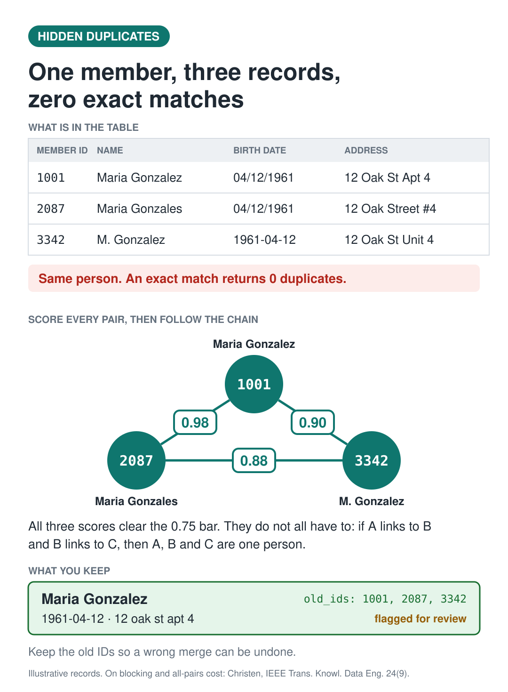

# Record linkage in PySpark: finding duplicates that exact matching misses

Three rows. One person. Zero exact matches.

| member_id | name | birth date | address |
|---|---|---|---|
| 1001 | Maria Gonzalez | 04/12/1961 | 12 Oak St Apt 4 |
| 2087 | Maria Gonzales | 04/12/1961 | 12 Oak Street #4 |
| 3342 | M. Gonzalez | 1961-04-12 | 12 Oak St Unit 4 |

`GROUP BY name, dob, address` returns nothing. `SELECT DISTINCT` returns three rows.
The records are not identical, so the only way to find them is to stop asking whether
they match and start scoring how close they are.

`find_hidden_duplicates.py` does that in five steps, in PySpark, on Databricks or a laptop.



## The five steps

**1. Standardize.** `12 Oak Street #4`, `12 Oak St Unit 4` and `12 Oak St Apt 4` all
become `12 oak st apt 4`. Two birth dates read `04/12/1961` and one reads `1961-04-12`;
all three become one date. This is not fixing the data, it is making it comparable.

**2. Block.** Comparing every row to every other row is `n(n-1)/2` pairs — about
500 billion at a million members, growing with the square of the table. So only compare
records that already share something. Here the key is the first four letters of the last
name plus the birth year. All three Gonzalez records land in `gonz1961` and get compared.
Maria Gomez, born 1975, never does.

The cost of blocking is the duplicate you never see: a typo *inside* the key puts a record
in the wrong block. Mitigate by running a second pass on an unrelated key, such as phone
plus ZIP, and unioning the candidate pairs. The script warns on oversized blocks, because
a common surname paired with a common birth year will blow up the join.

**3. Score.** For name and address, count the single-character edits that turn one string
into the other (Levenshtein distance) and divide by the length of the longer string, giving
0 to 1. Birth date scores 1 if it matches and 0 if it does not. Average the three.

```
1001 vs 2087   0.98
1001 vs 3342   0.90
2087 vs 3342   0.88
```

**4. Group.** The step that makes three records harder than two: matching *pairs* are not
*groups*. If 1001 links to 2087 and 2087 links to 3342, all three are one person — even if
1001 and 3342 score below the bar against each other. This is connected components on a
graph whose nodes are records and whose edges are matching pairs.

The script does it with a small iterative join, so it needs no extra library. If your
cluster has GraphFrames, `connectedComponents()` replaces that loop in one line; the call
is in a comment at that step.

**5. Merge.** One row per group. Longest value wins, so `Maria Gonzalez` survives and
`M. Gonzalez` does not. Records matching nothing keep their own row — singletons are not
dropped. The original IDs are kept in `old_ids`, because eventually you will merge two
real people and you will want them back.

```
grp  | name           | dob        | addr            | old_ids            | needs_review
1001 | maria gonzalez | 1961-04-12 | 12 oak st apt 4 | [1001, 2087, 3342] | true
4410 | maria gomez    | 1975-07-30 | 98 elm ave      | [4410]             | false
```

## Two thresholds, not one

```python
MERGE_AT  = 0.75   # pairs at or above this are treated as the same person
REVIEW_AT = 0.85   # ...but anything below this is worth a human look
```

A group is flagged `needs_review` if it holds three or more records, or if a pair scoring
under `REVIEW_AT` is what holds it together. Those are the groups a person should see
before anything is merged.

Both numbers are placeholders. Tune them by scoring your own data, sampling pairs from each
score band, and checking them by hand — that tells you where false matches start, and the
automatic bar goes above it.

## Why a false merge is the expensive error

A missed duplicate leaves a person's history split. A false merge combines two people's
histories, and it may not surface until someone gets a decision nobody can explain. That
asymmetry is why this script links rather than deletes: `old_ids` makes a bad merge a
reversal instead of a reconstruction.

## Running it

```bash
pip install pyspark
python find_hidden_duplicates.py
```

On Databricks, paste the script into a notebook and delete the `SparkSession` line —
`spark` already exists there. Replace the sample `createDataFrame` with your own table.

Tested on PySpark 4.3.0. The sample data is illustrative; the names, dates and addresses
are invented.

## Scaling notes

- Step 2 is the one that decides whether this runs at all. Cap block sizes before the join.
- Step 3 is a column expression, so it distributes; the Python loop version does not.
- Step 4's iterative join grows lineage. Checkpoint inside the loop on long chains, or use
  GraphFrames, which checkpoints for you.
- For production work at scale, a purpose-built library such as Splink is worth comparing
  against this, particularly for probabilistic scoring rather than a hand-weighted average.

## Reference

Christen, P. *A survey of indexing techniques for scalable record linkage and deduplication.*
IEEE Transactions on Knowledge and Data Engineering, 24(9). The source for the all-pairs
cost and for blocking's recall tradeoff.
